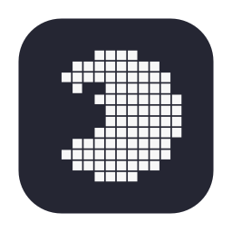

<p align="center">
  
</p>

<h1 align="center">PAC-MEN-U</h1>

<p align="center">
  맥 메뉴바 아이콘을 팩맨이 <b>먹었다 뱉었다</b> 하는 메뉴바 정리 앱<br>
  <i>A macOS menu bar organizer where a pixel pacman eats (hides) and spits out (shows) your menu bar icons.</i>
</p>

<p align="center">
  
</p>

## 사용법

- **팩맨 클릭** — 구분점(`‹`) 왼쪽의 아이콘들을 챱챱 먹어서 숨깁니다. 다시 클릭하면 뱉어서 보여줍니다.
- **팩맨 우클릭** — "팩미의 뱃속": 숨겨진 메뉴들이 `[앱 아이콘] 이름` 리스트로 나오고, 클릭하면 그 메뉴가 열립니다.
- **⌘ + 드래그** — 메뉴바 아이콘을 `‹` 왼쪽/오른쪽으로 옮겨서 먹힐 아이콘을 정합니다.

## 🕳️ 노치 구출 (v0.2)

맥북의 카메라 노치 뒤로 밀려 들어가 **보이지도 눌리지도 않던 아이콘**을 팩미가 찾아냅니다.

- **가려진 개수** — 팩맨에 마우스를 올리면 툴팁에 몇 개가 가려졌는지 나옵니다.
- **자동 구출** — 가려지는 순간 팩미가 알아서 챱! 하고 먹어서 자리를 비웁니다. (기본 켜짐, 수동으로 뱉은 뒤엔 아래 "자동으로 다시 먹기" 설정 시간만큼 유예)
- **우클릭 → 🕳️ 노치에 가려짐** — 자동 구출을 꺼둔 경우에도 가려진 아이콘 목록이 뜨고, 클릭하면 마우스가 닿지 않아도 그 메뉴가 열립니다.

## 🍽️ 팩미 바 (v0.3)

**팩맨이 입을 벌리면**(클릭해서 뱉으면) 메뉴바 바로 아래에 아이콘 바가 펼쳐집니다. 뱉었는데도 노치에 가려서 안 보이는 아이콘들이 여기 나오고, 클릭하면 그 앱의 메뉴가 열립니다.

메뉴바가 아니라 우리가 직접 그리는 창이라 **노치의 영향을 받지 않습니다** — 노치를 지나 왼쪽까지 얼마든지 뻗을 수 있습니다. (`⚙️ 설정 → 뱉을 때 팩미 바 열기`로 끌 수 있고, 먹은 상태에서도 우클릭 메뉴의 `🍽️ 팩미 바 열기`로 뱃속을 바로 볼 수 있습니다.)

## 설정 (우클릭 → ⚙️)

| 설정 | 설명 |
|---|---|
| 로그인 시 자동 실행 | macOS 로그인 항목에 등록 |
| 먹은 상태 기억하기 | 재실행/재부팅 시 먹은 상태 그대로 복원 |
| 뱉을 때 팩미 바 열기 | 뱉은 뒤에도 노치에 가려진 게 있으면 아이콘 바로 펼치기 (기본 켜짐) |
| 노치에 가리면 자동으로 먹기 | 아이콘이 노치 뒤로 숨는 순간 자동으로 먹어서 구출 (기본 켜짐) |
| 뱉은 뒤 자동으로 다시 먹기 | 10초(기본) / 30초 / 1분 — 항상 켜짐, 끌 수 없음 |

## 설치 / 빌드

```sh
./build.sh        # swiftc 빌드 → 서명 → /Applications 설치
open /Applications/PAC-MEN-U.app
```

- macOS 13+, 별도 의존성 없음 (Swift 단일 파일, `main.swift`)
- 서명 identity는 `build.sh`에서 본인 인증서로 바꿔주세요 (ad-hoc `-s -`도 되지만 재빌드마다 아래 권한을 다시 켜야 합니다)

### 권한

뱃속 리스트(숨긴 메뉴 이름 읽기/클릭 전달)에 **손쉬운 사용(Accessibility)** 권한이 필요합니다.
시스템 설정 → 개인정보 보호 및 보안 → 손쉬운 사용에서 PAC-MEN-U를 켜주세요.
권한 없이도 먹기/뱉기 자체는 동작합니다.

## 동작 원리

- 숨김은 구분자 `NSStatusItem`의 length를 10,000pt로 확장해 왼쪽 아이콘들을 화면 밖으로 밀어내는 방식 (Hidden Bar와 같은 트릭, 프라이빗 API 없음)
- 뱃속 리스트는 Accessibility API로 각 앱의 메뉴바 아이템 이름/위치를 읽고, 클릭 시 `AXPress`를 전달
- 팩맨은 12×12 도트 그리드를 코드로 그린 템플릿 이미지 — 다크/라이트 메뉴바 톤을 시스템이 자동으로 맞춰줍니다

---

*"맥에서 쓰는 간단한 앱 20개 만들기" 프로젝트의 1호입니다.* 🕹️
